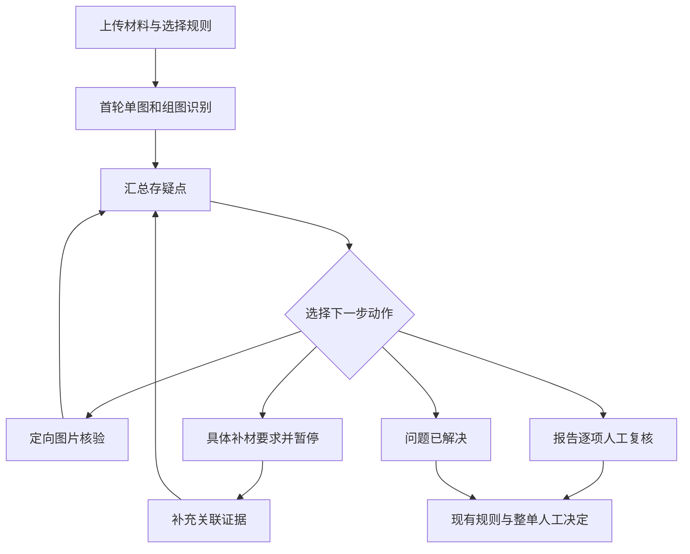

# AI-Powered Intelligent Underwriting Project for Distributed Photovoltaic Property Insurance

**光伏核保工作台 v2 · 证据核验与人工逐项复核**

面向屋顶式、车棚顶式分布式光伏财产险的核保辅助原型，结合材料识别、组件型号与参数检索、既有核保规则及风雪风险筛查，为人工核保提供可追溯的证据与建议。

v2 在既有单图和组图识别之后增加存疑点驱动的核验循环：模型选择相关证据与核验方式；需要补材时暂停，补充后恢复相关问题；业务分类争议交由核保人员逐项确认。

## 当前能力

- 按所选规则执行材料识别，保留首轮单图与组图结果。
- 汇总视觉不确定、真实冲突、关键证据缺失和业务分类争议。
- 在有限调用预算内，选择单图或组图定向核验，保存调用与证据。
- 增量补材、替换材料、保留原件、服务中断恢复及版本检查。
- 将风险事实、风险分类、承保意见分别保存，支持候选答案与“其他”。
- 未处理必需项或待补材时阻止整单通过；沿用现有规则和权限。
- 组件型号与来源检索、人工参数核验，以及原有风雪专项筛查。



核验循环有调用上限、重复证据检查、引用校验和审计记录。失败、预算耗尽或冲突未解决时，保留待处理状态。人工选择不直接作为模型训练真值。

## 本地运行

建议使用 Python 3.12。以下为 Windows PowerShell 命令，在仓库目录执行：

```powershell
py -3.12 -m venv .venv
.\.venv\Scripts\python.exe -m pip install -e ".[dev]"
Copy-Item .env.example .env
```

编辑 `.env`，按需填写自己的视觉模型、Solar-Stack 和地图服务配置。模型名称须与账号已开通的服务一致。真实识别需要有效的模型密钥；请勿提交 `.env`。

之后双击 `启动工作台.cmd`，或运行：

```powershell
.\.venv\Scripts\python.exe start_workbench.py
```

默认地址：<http://127.0.0.1:8002/evaluation>。已有报告中可进入“证据复核与整单提交”页面。v2 使用独立的本地案件数据库和浏览器缓存名称。

## 测试

无需真实模型密钥的核验测试：

```powershell
$env:PV_VERIFICATION_ENABLED = "true"
.\.venv\Scripts\python.exe -m pytest tests/unit/test_verification_v2.py -q
```

安装 Node.js 后，可运行前端测试：

```powershell
node --test tests/frontend/*.test.cjs
```

v2 本地验收：新增核验链路 36 项通过，前端 48 项通过。测试使用模型替身和 HTTP MockTransport，验证真实接口、持久化、状态与约束，不代表真实图片识别准确率。完整本地兼容性回归曾为 831 项通过、4 项原有失败，失败涉及模型配置、报告摘要一致性及卫星参数默认值；详见版本说明。

## 目录

| 目录 | 内容 |
|---|---|
| `backend/app/verification/` | 存疑点、核验循环、补材、复核与审计 |
| `backend/app/pipeline/` | 原有核保流程及 v2 接入 |
| `backend/app/rules/` | 既有规则、选择方案与证据覆盖 |
| `frontend/` | 工作台及真实可操作的复核页面 |
| `component-model-workbench/` | 组件型号、参数与来源检索 |
| `tests/` | 接口、规则、核验链路与前端测试 |
| `examples/wind-snow/` | 明确标注为测试输入的风雪算例 |

## 范围与限制

- 这是核保辅助原型，最终业务决定由有权限的人员作出。
- 沿用既有业务口径，不让模型自行制定涉水、拒保或定价规则；没有定价依据时不计算加费金额。
- 本次风险识别改造未修改抗灾能力计算逻辑。
- 首轮未产生疑点的自信错误不会被核验循环自动发现；真实效果需要独立样本评测。
- 默认本地演示模式；启用已有角色认证时，必须自行配置管理员账号及密码。
- 仓库不包含本地密钥、原始案件照片、案件数据库、实际运行记录、虚拟环境和历史交付归档。旧文档中可能提到这些本地文件，它们不属于公开源码包。
- 数据目录中的型号资料保留来源信息；本仓库未额外授予第三方资料的使用许可。

详细文件清单与边界见 [v2 改动与验收说明](v2改动与验收说明.md)。原仓库介绍保留于 [仓库原始说明](docs/仓库原始说明.md)。
