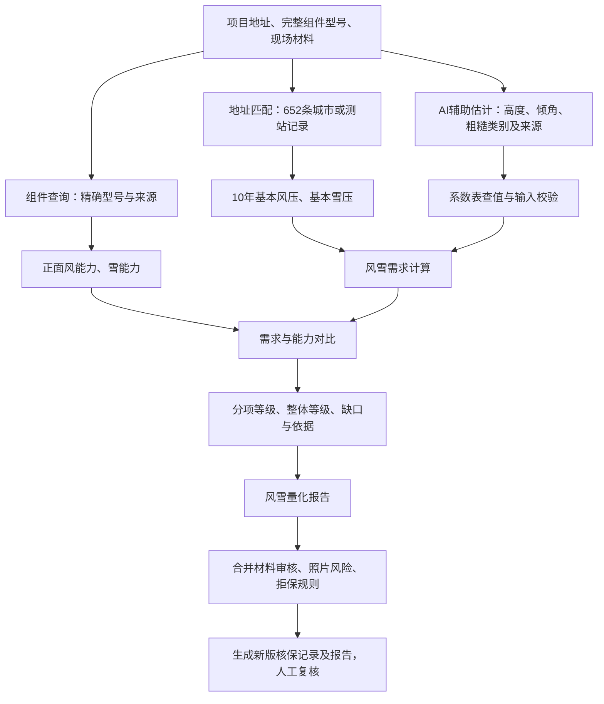

# 业务流程与模块边界

## 实现分工
- 型号查询：backend/app/api/unified_risk.py → 现有组件查询provider；保留缓存600秒。
- 地点匹配：backend/app/catastrophe/front_load_screening/city_lookup.py。
- 系数、荷载：同目录city_engine.py、city_rules.json。
- 能力提取、分档、报告：同目录unified.py。
- 正式核保：pipeline/core.py 调用同一个 assess_unified，不再自动执行旧历史天气抗灾量化。
- 决策：decision/engine.py 保留其他拒保规则的优先级；低风雪等级不能覆盖拒保。
- 整单报告：reports/generator.py；页面frontend/underwriting-report.js。
- 界面：frontend/risk-lab.html、risk-lab.js；evaluation.html保存安装参数并带入整单。

天气历史信息可作为其他核查背景，不能作为本模块风雪压输入。旧历史案件保留兼容显示；不要批量重算覆盖旧案件。

## 数据责任
业务确认能力字段映射、分档阈值、雪模型适用范围、地点选取及系数依据；技术实现校验、版本、来源追踪和报告合并；AI识别只提供候选及证据，确定性计算交给程序。
